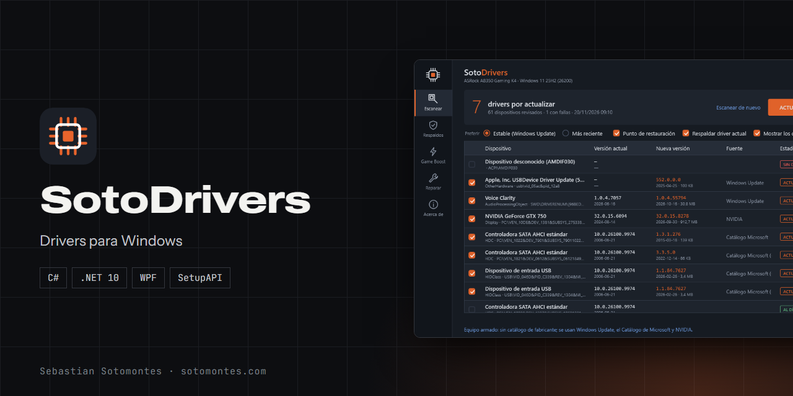
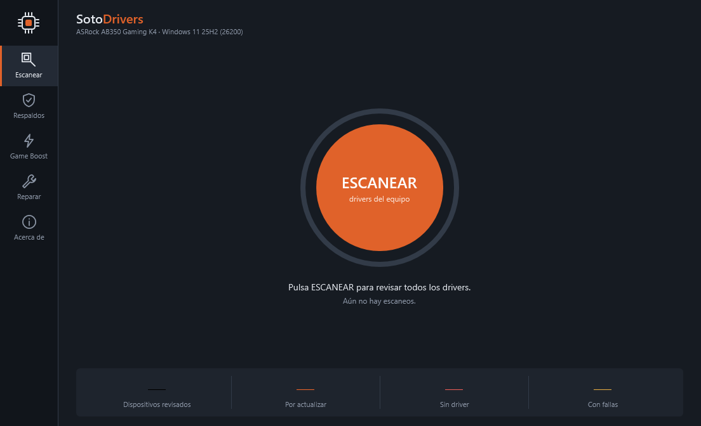
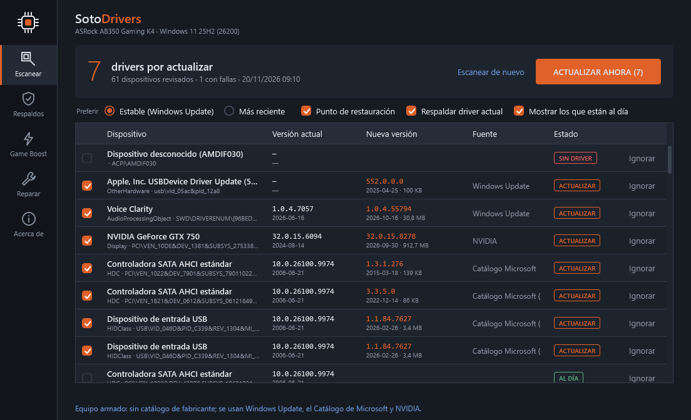
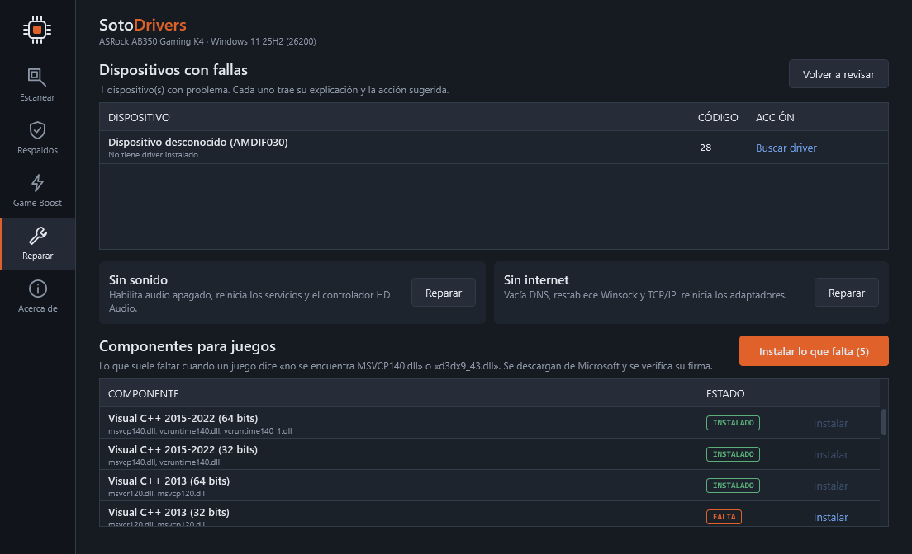
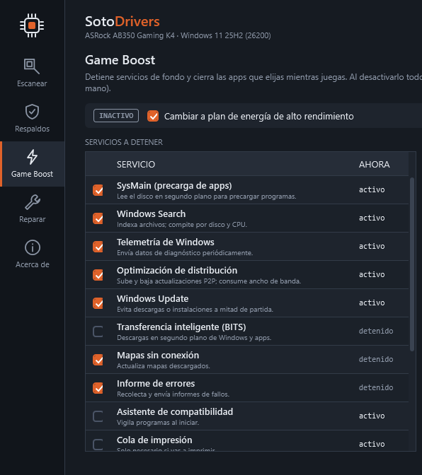
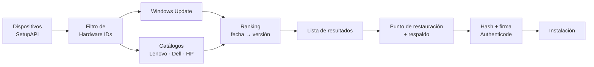

Escanea, actualiza, respalda y repara los drivers de Windows usando solo fuentes oficiales: Windows Update y los catálogos públicos de Lenovo, Dell y HP.

<a href="https://sotomontes.com/#sotodrivers"><b>Ver en sotomontes.com</b></a> · <a href="#cómo-se-usa">Cómo se usa</a> · <a href="#cómo-funciona-por-dentro">Cómo funciona</a> · <a href="#novedades">Novedades</a>

| Ficha técnica | |
|---|---|
| **Autor** | Sebastian Sotomontes |
| **Tipo** | Drivers y mantenimiento |
| **Plataforma** | Windows 10 y 11 (64 bits) |
| **Versión** | 0.1.0 |
| **Estado** | En desarrollo |
| **Stack** | C# · .NET 10 · WPF · SetupAPI · Windows Update Agent |
| **Código** | Privado. Esta página es solo una presentación. |

---

## Qué es

SotoDrivers revisa cada dispositivo del equipo, lee el driver que tiene instalado y lo compara con lo que ofrecen Microsoft y el fabricante. Lo que hay que actualizar aparece en una sola lista y se instala con un botón, con punto de restauración y respaldo del driver anterior antes de tocar nada.

No usa servidores propios ni de terceros: solo habla con Microsoft, Lenovo, Dell y HP, y no envía telemetría.

## Novedades

**Versión 0.1.0**

- Primera versión con cuatro módulos: **Escanear**, **Respaldos**, **Game Boost** y **Reparar**.
- **Fuentes oficiales**: Windows Update y catálogos públicos de Lenovo, Dell y HP, más NVIDIA y el Catálogo de Microsoft cuando aplica.
- **Interfaz nueva** de tema oscuro sobrio: botón de escaneo redondo con anillo animado, resultados con *Actualizar ahora* y menú lateral con iconos.
- **Volver a una versión anterior** de verdad, aunque Windows normalmente no deje bajar de versión.
- Autoprueba integrada: 36 pruebas locales y 40 con conexión a los catálogos reales.

## Cómo se usa

1. Pulsa **ESCANEAR**. En segundos revisa todos los dispositivos.
2. Mira la lista: versión actual, versión nueva, fecha, tamaño y de dónde viene cada driver.
3. Elige la preferencia: **Estable** (Windows Update primero) o **Más reciente** (el de fecha más nueva de cualquier fuente).
4. Deja marcados *Punto de restauración* y *Respaldar driver actual*, y pulsa **ACTUALIZAR AHORA**.
5. Si algo sale mal, en **Respaldos** restauras la versión anterior con un clic.

## Funciones

| Módulo | Qué hace |
|---|---|
| **Escanear** | Enumera cada dispositivo, lee versión, fecha e INF de su driver y lo compara con las fuentes oficiales. Marca los que no tienen driver. |
| **Respaldos** | Exporta los drivers de terceros y restaura cualquier versión guardada, forzando ese INF aunque haya uno más nuevo. Lista y crea puntos de restauración. |
| **Game Boost** | Detiene servicios de fondo y cierra las apps que elijas, y activa el plan de alto rendimiento. Guarda el estado antes de tocar nada y lo deja todo como estaba al desactivarlo. |
| **Reparar** | Explica en español cada código de error de dispositivo con su acción, arregla "sin sonido" y "sin internet", e instala los componentes que faltan para juegos (Visual C++ 2008–2022, DirectX heredado, .NET 3.5). |

  
  

## Cómo funciona por dentro

### Flujo

### 🔬 Cómo decide qué actualizar

1. **Inventario**: SetupAPI recorre los dispositivos presentes; de cada uno se leen el estado (código de problema), la versión, la fecha y el INF del driver.
2. **Filtro**: solo se comparan identificadores reconocibles (`PCI\VEN&DEV`, `HDAUDIO\FUNC&VEN&DEV`, `USB\VID&PID`, `ACPI\XXXX####`…). Volúmenes, dispositivos virtuales y colas de impresión quedan fuera para no proponer cambios absurdos.
3. **Fuentes**:
   - *Windows Update* mediante la API oficial del agente, solo actualizaciones de tipo driver.
   - *Lenovo*: catálogo por tipo de máquina, con rangos de versión por Hardware ID y SHA-256.
   - *Dell*: índice del catálogo → catálogo por SKU, con coincidencia PCI/PnP y SHA-256.
   - *HP*: catálogo por plataforma y versión de Windows, dispositivo → paquete, con SHA-256.
4. **Ranking** igual al que usa Windows: primero la fecha del driver, después la versión.

### 🔬 Seguridad

- **Punto de restauración** antes de instalar. Si Windows limita la frecuencia de creación, la ajusta solo durante la operación y la deja como estaba.
- **Respaldo** del driver actual antes de reemplazarlo.
- Ningún instalador se ejecuta sin que coincidan el **hash** publicado por el fabricante **y** una **firma Authenticode** válida.
- Para volver atrás no basta con reinstalar el INF viejo (Windows lo ignora si hay uno más nuevo), así que se instala de forma forzada sobre el dispositivo concreto.

---

© 2026 Sebastian Sotomontes. Todos los derechos reservados.
